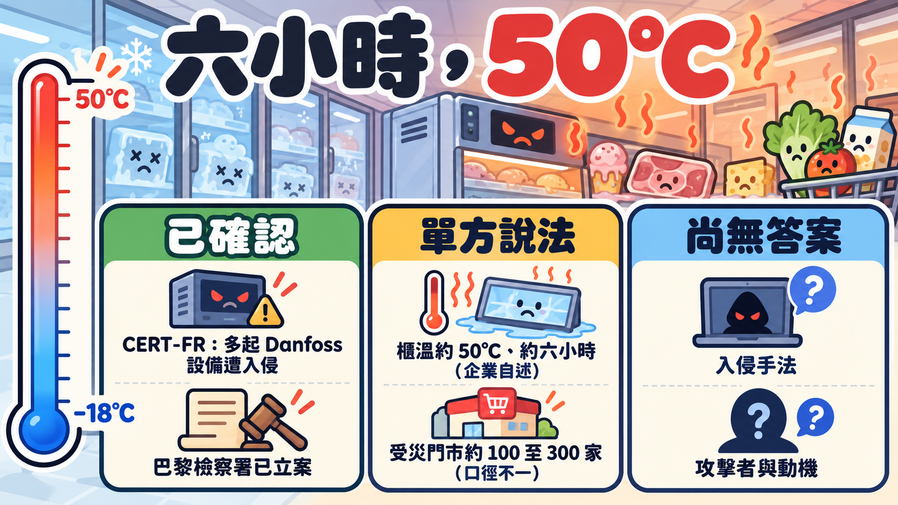
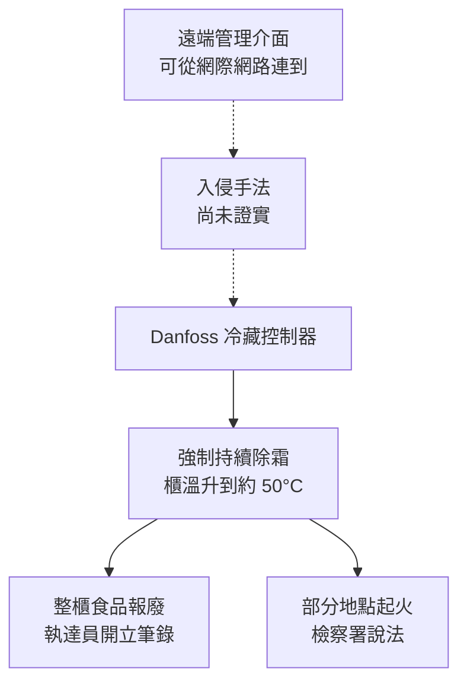

# 六小時、50°C：法國超市冷鏈被遠端加熱，缺口在哪裡

> 事件仍在發展，數字與說法以 2026 年 10 月 13 日前的報導為準。

週一早上，一家 Intermarché 門市的店長要做的事，和賣東西完全無關：把整排冷藏櫃清空，請執達員（huissier，法院執行官）到場開立筆錄，然後把裡面所有的生鮮和冷凍食品丟掉。Les Mousquetaires（Intermarché 的母集團）給受災門市的處理程序就是這三步（franceinfo）。

起因是前一晚。據集團對 Agence Radio France 的說法，丹麥廠商 Danfoss 供應的冷藏設備管理系統，在週日到週一的夜裡遭到攻擊，冷凍櫃與冷藏櫃的設定溫度被改成 50°C。冷凍櫃平常該待在零下十八度上下，這中間差了將近七十度。

同一個週一，三個彼此競爭的零售集團，被同一家設備商的同一類系統拖下水。

*虛線是目前沒有官方確認的環節。50°C 與約六小時的說法來自 Les Mousquetaires 與 Reuters 轉述。*

## 先把數字釘住：沒有人給得出同一個數字

受災規模是這起事件最混亂的部分。把各方說法並排看，會發現它們量的是不同的東西。

| 連鎖 | 說法 | 誰說的 | 性質 |
|---|---|---|---|
| Intermarché／Netto | 至少 300 家 | Intermarché 向 AFP | 企業自述 |
| Intermarché | 約 150 家門市冷櫃被加熱到 50°C，持續約六小時 | 集團發言人（Reuters 轉述） | 企業自述 |
| Intermarché | 約 100 家須丟棄庫存 | Les Mousquetaires 初步統計（AA） | 企業自述，較早期 |
| Intermarché | 200 至 300 家 | France Inter 消息來源 | 匿名消息 |
| Système U | 不到 100 家 | franceinfo | 媒體報導 |
| Carrefour | 80 家（全法約 6,000 家） | Le Parisien／Reuters | 企業說法 |
| Monoprix | 約 5%，約 30 家 | franceinfo／AFP | 媒體報導 |
| E.Leclerc | 「數家」，未給數字 | 向 AFP 確認供應商受影響 | 企業自述 |

數字從一百到三百不等，另有法媒估整體在 250 至 350 家之間（BleepingComputer 轉述）。有的算「冷櫃被加熱」，有的算「必須丟貨」，有的算「系統受影響」，清點的時間點也不同。讀這類報導，先問那個數字量的是哪一件事。

損失同樣只有零散的估計。阿爾薩斯 Haguenau 的兩家門市（一家 Intermarché、一家 Leclerc）估計合計約 27 萬歐元（地方報導，Lycos 彙整）。吉倫特省一家 Intermarché 的店主向 Le Monde 估計，自己報廢的存貨進貨成本約 2.1 萬歐元，並說冷藏室達到 50°C、除霜程序被拉長到八小時。Intermarché 的 Thierry Cotillard 估計全國一天的損失可達數千萬歐元，France Inter 的消息來源則說「數百萬歐元」。這些都是個別估算，沒有業界或官方的合計。

## 被拿來用的，是冰箱本來就有的功能

BFMTV 的報導說，攻擊者遠端觸發了「強制除霜」。除霜是冷藏設備的例行功能：蒸發器表面會結霜，系統定期短暫加熱把霜融掉。這是單一媒體的說法，Danfoss 與官方都還沒公布操作細節。

如果這個說法成立，問題的樣子就很不一樣。攻擊者不需要寫出什麼破壞性程式，只要讓一個合法、設計給維修用的動作停不下來。

報導裡沒有任何一方談到：控制器之外，有沒有獨立於軟體的過溫保護？這是本文的提問，不是已知事實。

另一個後果在檢察署的聲明裡：巴黎檢察署表示調查目的包括釐清攻擊與食物損失和「火災」之間的關聯。火災的規模、地點，目前沒有公開細節。

## 三家對手共用一個設備商

Intermarché、Système U、Leclerc 在同一晚出現同樣症狀，共同點是冷藏設備的供應商。各家自己的防火牆和員工訓練再扎實，也管不到設備商那一端的系統。Les Mousquetaires 表示，這種規模的冷藏系統攻擊他們從未遇過（AA）。

## 修補程式早就有了，為什麼還是中招

**2025 年就公開的事。** Danfoss 在 2025 年 3 月發布公告 DSA-2025-03-01，說明 AK-SM 8xxA 系列有認證繞過漏洞（CVE-2025-41450），修補版本是 4.2。美國 CISA 在 2025 年 5 月 20 日發布 ICSA-25-140-03，8 月 26 日更新，8 月的更新另加入命令注入（CVE-2025-41451，可在已通過驗證的情況下遠端執行程式碼）和網頁介面設定處理不當（CVE-2025-41452，可能造成服務中斷），修補版本是 4.3.1。CISA 當時寫明「沒有已知的公開利用」，並建議這類設備不要從網際網路直接連到，要放在防火牆後，必要的遠端存取用 VPN。資安公司 Claroty 的 Team82 是通報者，後來公開研究細節，並引用 Censys 掃描結果，指出有 2,765 台 AK-SM 800A 的管理介面暴露在網路上。

**這次事件裡，官方與廠商怎麼說。** 法國 CERT-FR 在 10 月 12 日發出警報 CERTFR-2026-ALE-012，原文寫「已知悉多起 Danfoss AK-SM 與 AK-SC 系列設備遭入侵」，並指出把管理介面暴露在網際網路上違反最佳實務。警報沒有公布入侵手法、CVE 編號或入侵指標，也沒有說暴露就是入侵的原因。Danfoss 對 AFP 說，受影響設備多半是已停止獲得軟體和安全更新的舊產品；對冷凍業媒體 Cooling Post 則進一步說，AK-SM800 在 2021 年宣布終止生命週期，AK-SC355 在 2016 年已淘汰，另外「目前仍在售的 AK-SM800A 系統」受影響的，跑的是過時韌體。Danfoss 並說早已建議客戶把受支援的系統更新到最新韌體、把舊系統遷移到新一代方案。

**能不能接到 2025 年那批 CVE，官方沒有說。** 這裡的關鍵是 AK-SM800A：它正是 CISA 與 Claroty 談的 AK-SM 8xxA／800A 這個系列，而 4.2 與 4.3.1 的修補版本早在 2025 年就有了。所以最直接的推論是「有修補版本，但現場沒更新」。這仍是推論：CERT-FR 沒有指認 CVE，法國總理身邊的匿名人士只說，ANSSI（法國國家資訊系統安全局）已發現「一家丹麥公司提供的軟體中有漏洞」並聯絡了廠商。

另一個旁證是曝險數字。Predicta Lab 執行長 Baptiste Robert 說，他找到 2,752 台暴露在網際網路上的 Danfoss 系統，其中 1,590 台在法國（BleepingComputer 轉述，單一研究者的說法）。這和 Claroty 引用的 2,765 台量級相近，但兩組數字的掃描方法和時間不同，不能直接比較。

把這幾件事擺在一起，可以確定的有三點：廠商說受害的是停止更新的舊品，或沒有更新韌體的現行機型；CERT-FR 確認多起設備遭入侵；「管理介面連得到網際網路」這件事，至少從 2025 年起就被 CISA 公開警告過。

**這個風險能往外推到多遠。** 把上面的事實往外推，最直接的結論是：連得到網際網路、又停止更新或沒更新韌體的 OT 設備，是風險最高的一群。這是推論，不是這次事件的鑑識結論：入侵路徑官方沒有公布，「舊品、沒更新」是 Danfoss 對受害設備的描述。風險要成立，通常三個條件要同時具備：設備連得到（從網際網路，或攻擊者已在內網）、設備有可利用的弱點（未修補的漏洞、預設或弱密碼、沒有驗證的管理介面）、設備上有「改了就會出事」的功能。停止更新讓第二點更容易成立；更新過的設備如果密碼弱、介面暴露，一樣有風險，停更但沒有連網的設備，風險則低得多。

這和一般說的 DoS 也不同。DoS 是灌流量或癱瘓服務；報導描述的是設備照常運作、參數被改掉：強制除霜、溫度設定被改成 50°C，影響的是設備的完整性與可用性，並帶來食物報廢、起火這類物理後果。「強制除霜」目前只有 BFMTV 一家這樣說，Danfoss 與官方沒有公布操作細節。對應到後面的自查清單，要看的是三件事：設備是否暴露在外、是否仍有安全更新、設定被改時有沒有獨立於設備之外的告警或硬體保護。

## 還沒有答案的事

| 問題 | 目前狀況 |
|---|---|
| 攻擊者怎麼進去的 | CERT-FR 與檢察署都沒有公布。可能與 2025 年那批漏洞有關，也可能無關 |
| 是誰幹的 | 沒有團體宣稱，沒有任何政府歸因 |
| 動機 | 沒有勒索要求被報導；動機未知 |
| 火災 | 巴黎檢察署提到「火災」，無規模與地點；火災是否由攻擊造成尚待調查 |
| 是否擴及其他國家 | Sekoia 分析師 Felix Aime 說西班牙、葡萄牙、波蘭、德國、比利時也受影響，屬單一分析師說法，無政府確認。法國政府只說正與歐洲夥伴協調 |
| 與 Ahold Delhaize 的關聯 | 同一天，荷蘭零售集團 Ahold Delhaize 宣布網路出現資安事件並讓部分系統離線；公司說沒有理由把兩件事連在一起。有勒索組織宣稱是自己幹的，屬團體自稱，未證實 |
| 與美國軍方商店的關聯 | 2026 年 8 月底，美國至少六間 commissary 的冷凍設備同時故障，Fort Huachuca 官方說「所有冷凍食品都壞了」。官方沒有說明原因，與本次事件是否有關完全未知 |

最後一列最值得注意。如果軍方商店的事件之後被證實是惡意操作，那麼「法國」就只是一系列事件中最大聲的一次；如果是巧合，我們也得到了一個提醒：現在還沒有人有辦法在事發當下分辨兩者。

## 如果你管的是冷鏈，這張清單今天就能用

下面不是事件報導裡的結論，是本文根據攻防兩面的常見做法整理的建議，供自查。

**先看自己露不露在外面。** 把自己對外公開的 IP 位址範圍丟進 Shodan、Censys 查一遍，看冷藏、空調、能源管理這類設備的管理頁面有沒有被索引到。Claroty 引用的 Censys 數字，就是這類公開掃描的結果。

**拿掉直接暴露。** CISA 在 2025 年對這個產品系列就建議：不要讓設備可以從網際網路連到，放在防火牆後與企業網路隔離，需要遠端維護時走 VPN 並保持更新。CERT-FR 這次的警報也要求斷開或過濾 AK-SM、AK-SC 的存取，必須遠端管理時暫時限制在可信任的 IP。設備商和維護廠商的遠端通道也要納入，確認誰能連、從哪裡連、有沒有雙因素。

**懷疑已經被入侵，照 CERT-FR 的順序。** 警報列出的步驟是：存取限制為僅授權的服務商、原廠重置、套用所有可用的安全修補、輪換所有密鑰與機密資訊、檢查現有帳號、全面重新設定設備。

**盤點「已經不再更新」的設備。** 冷鏈設備以十年計算壽命，軟體支援週期通常短得多（這是本文的一般性類推，不是來自報導）。Danfoss 說已建議汰換舊產品；汰換的預算多半落在零售商身上（本文類推）。資產清冊上要有「廠商停止更新的日期」這一欄，才有辦法在預算會議上談。

**偵測要獨立於控制器之外。** 如果櫃溫感測與告警完全依賴被攻擊的同一套系統，攻擊者改了設定，告警也跟著失靈。獨立的溫度記錄器、獨立的簡訊告警、控制器上的除霜時間異常告警，都比事後才發現便宜。控制器上方有沒有一個不受軟體影響的硬體過溫保護，也值得現場去看一眼。

**演練「控制器被接管」的現場作法。** 這次受災門市用人工清空、請執達員驗證、銷毀食品，過程有條有理，但那是在事發後。事前該決定的是：誰有權判斷哪些食品還能救、什麼時候切到手動、保險理賠需要什麼憑證（執達員筆錄的用途，本文推測與理賠舉證有關，報導沒有明講）。

**合約裡寫清楚停止更新時要通知。** 設備商停更前多久要通知、停更後的安全責任歸誰、遠端存取的稽核記錄誰保管，這些是採購合約的條款，不是事件發生後才能補的功課。

## 帶走的事

目前能確定的很少：CERT-FR 確認多起 Danfoss 設備遭入侵，廠商說受害的是停止更新的舊品或沒更新韌體的機型，受災企業說櫃溫被調到約 50°C，檢察署已立案。入侵手法、攻擊者、動機都還沒有答案，也沒有哪個零時差漏洞或特殊惡意程式被報導。

歐盟農業專員 Christophe Hansen 在 X 上譴責這起攻擊，說食物被工具化已成現實。

你的冷藏櫃現在是誰在遠端管理，從哪裡連進來，那台設備的廠商還在不在更新它？

## 來源

**主要來源**

- Lycos，[Cyberattaque : des frigos d'Intermarché, U et Leclerc visés](https://news.lycos.fr/sujet/cyberattaque-des-frigos-d-intermarche-u-et-leclerc-vises-98684)，2026-10-12 發布、10-13 更新；彙整 33 則報導的新聞聚合頁，非單一署名報導。
- Anadolu Ajansı，[France : une cyberattaque d'ampleur perturbe les systèmes frigorifiques de plusieurs enseignes de grande distribution](https://www.aa.com.tr/fr/france/france-une-cyberattaque-d-ampleur-perturbe-les-syst%C3%A8mes-frigorifiques-de-plusieurs-enseignes-de-grande-distribution/4086077)，2026-10-12，署名 Ben Amed Azize Zougmore。

**事件報導**

- CERT-FR（ANSSI 體系），[CERTFR-2026-ALE-012 Incident de sécurité ciblant les Danfoss série AK-SM et AK-SC](https://www.cert.ssi.gouv.fr/alerte/CERTFR-2026-ALE-012/)，2026-10-12（官方警報）。
- Cooling Post，[Danfoss moves to mitigate cyberattack](https://www.coolingpost.com/world-news/danfoss-moves-to-mitigate-cyberattack/)，2026-10-12（含 Danfoss 聲明）。
- AFP，[French supermarkets suffer refrigerator shutdown after unprecedented cyberattack](https://www.afp.com/en/french-supermarkets-suffer-refrigerator-shutdown-after-unprecedented-cyberattack)，2026-10-12。
- Le Monde，[Journée noire dans les supermarchés français après une cyberattaque massive](https://www.lemonde.fr/economie/article/2026/10/12/journee-noire-dans-les-supermarches-francais-apres-une-cyberattaque-massive_6792763_3234.html)，2026-10-12。
- franceinfo，[Des magasins Système U, Intermarché, E.Leclerc et Monoprix touchés par une cyberattaque contre leurs installations frigorifiques](https://www.franceinfo.fr/internet/securite-sur-internet/cyberattaques/des-magasins-systeme-u-et-intermarche-touches-par-une-cyberattaque-contre-leurs-installations-frigorifiques_8233720.html)，2026-10-12。
- CBS News（AFP／Reuters 轉述），[Hackers turn up the heat in refrigerators at hundreds of supermarkets in France, sparking fires and food losses](https://www.cbsnews.com/news/cyberattack-supermarkets-refrigerators-france-fires-food-losses/)，2026-10-12。
- ABC News（Reuters 轉述），[Hundreds of French supermarkets' fridges hacked in large-scale attack](https://www.abc.net.au/news/2026-10-13/french-supermarkets-hacked-causing-fires-and-food-loss/107258724)，2026-10-13。
- BleepingComputer，[Cyberattack shuts down refrigerators at French supermarkets](https://www.bleepingcomputer.com/news/security/cyberattack-shuts-down-refrigerators-at-french-supermarkets/)，2026-10-12。
- Help Net Security，[Cyberattacks hit European grocers](https://www.helpnetsecurity.com/2026/10/12/france-cyberattack-supermarket-freezers/)，2026-10-12。
- The Stack，[French supermarkets hacked: Danfoss vulnerabilities blamed](https://thestack.technology/french-supermarkets-hacked-danfoss-vulnerabilities-blamed)，2026-10。
- Ahold Delhaize，[Ahold Delhaize takes precautionary measures following cybersecurity incident](https://newsroom.aholddelhaize.com/ahold-delhaize-takes-precautionary-measures-following-cybersecurity-incident/)，2026-10-12（公司聲明）。

**漏洞與背景（官方與研究機構）**

- CISA，[ICSA-25-140-03 Danfoss AK-SM 8xxA Series](https://www.cisa.gov/news-events/ics-advisories/icsa-25-140-03)，2025-05-20 發布，2025-08-26 更新。
- Danfoss，[DSA-2025-03-01 Improper Authentication vulnerability in Danfoss AK-SM8xxA Series](https://www.danfoss.com/en/service-and-support/coordinated-vulnerability-disclosure/danfoss-security-advisories/dsa-2025-03-01/)，2025-03-24 發布，2025-09-01 更新。
- Claroty Team82，[Freeze the Controller, Defrost the Food](https://claroty.com/team82/research/freeze-the-controller-defrost-the-food-uncovering-vulnerabilities-in-danfoss-refrigeration-controllers)。
- Stars and Stripes，[Refrigeration outages at multiple US commissaries](https://www.stripes.com/theaters/us/2026-08-28/refrigeration-outages-multiple-us-commissaries-22684428.html)，2026-08-28。
